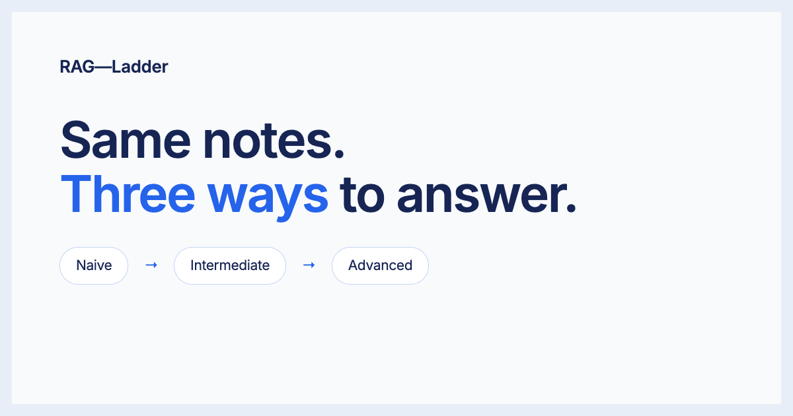
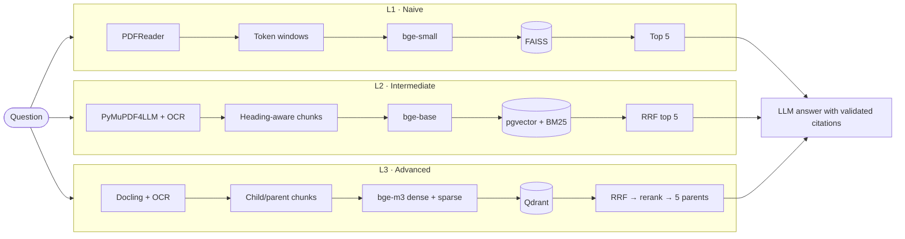
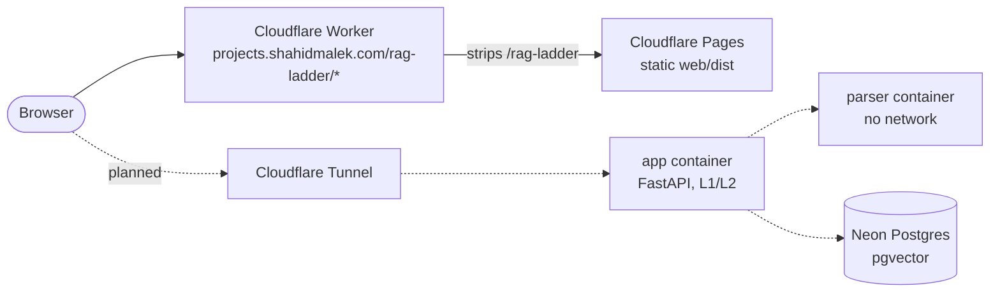

<div align="center">

# RAG-Ladder

**Same notes. Three ways to answer.** A measured climb from naive to advanced retrieval-augmented generation over student notes.

[**projects.shahidmalek.com/rag-ladder**](https://projects.shahidmalek.com/rag-ladder/)

[](requirements.txt)
[](app.py)
[](web/package.json)
[](#-status--roadmap)
[](LICENSE)



</div>

## Why this exists

Student notes are messy: scanned slides, tables, diagrams, half-formatted Markdown. A chatbot over them is only useful if it finds the right passage. RAG-Ladder builds the same question-answering app three times, each rung adding more sophisticated parsing, chunking and retrieval, and measures what each step actually buys on a fixed set of 200 questions.

## 🪜 The ladder

| | **L1 · Naive** | **L2 · Intermediate** | **L3 · Advanced** |
| --- | --- | --- | --- |
| **Parsing** | LlamaIndex `PDFReader`, plain page text | PyMuPDF4LLM page Markdown with automatic OCR | Docling with RapidOCR and table structure; captions for qualifying figures |
| **Chunking** | 400-token windows, 40 overlap | Heading-aware recursive chunks, 400 tokens | Docling HybridChunker children (400) grouped into same-heading parents (≤1500) |
| **Embeddings** | `BAAI/bge-small-en-v1.5` | `BAAI/bge-base-en-v1.5` | `BAAI/bge-m3` dense + learned sparse |
| **Vector store** | FAISS `IndexFlatIP` (exact) | PostgreSQL + pgvector (exact cosine) | Qdrant, embedded local mode |
| **Retrieval** | Dense top 5 | Dense 20 + BM25 20, reciprocal-rank fusion (k=60), top 5 | Dense 20 + sparse 20, RRF (k=60), shortlist 20 |
| **Reranking** | None | None | `BAAI/bge-reranker-v2-m3` cross-encoder, up to 5 parents |
| **Query handling** | Original question | LLM query rewrite; hosted sessions add recent chat history | LangGraph plan → retrieve → one retry if the best score is weak |
| **Where it runs** | Hosted demo (planned) or local | Hosted demo (planned) or local | Local only |

All three levels answer with the same provider chain (Groq `openai/gpt-oss-120b`, falling back to OpenRouter) and must cite the chunk IDs they used; uncited answers are replaced with "not found in the notes". Exact settings live in [`config.py`](config.py); step-by-step diagrams are in [`flow_diagrams.md`](flow_diagrams.md).



## 📊 Results at a glance

Frozen retrieval evaluation: 200 questions over 37 documents in four subjects, 184 answerable. Query processing (rewrite, retry) and answer generation were off; search was exact.

| Metric (answerable n = 184) | L1 | L2 | L3 |
| --- | --- | --- | --- |
| Hit@1 | 0.462 | 0.451 | **0.598** |
| Hit@5 | 0.777 | 0.793 | **0.826** |
| MRR@5 | 0.721 | 0.754 | **0.866** |
| Recall@5 (keywords) | 0.838 | 0.884 | **0.919** |
| Evidence coverage@5 | 0.831 | 0.854 | **0.888** |

- **L3 leads every headline metric, but the overall Hit@5 and evidence-coverage gaps are not statistically significant** (McNemar p = 0.243 for L3 vs L1 Hit@5; every paired coverage interval includes zero).
- **The clearer L3 gains are in ranking:** paired intervals for MRR@5 and keyword Recall@5 against L1 and L2 exclude zero, with the Recall gain over L2 borderline.
- **L3 helps most on cross-document questions** (coverage@5 0.817 vs 0.625 for L1) and **loses on same-document multipart and table/diagram/code questions** (0.714 and 0.683, below both earlier levels).
- **L2 is not uniformly better than L1:** Hit@1 is slightly lower (0.451 vs 0.462). Several components change between rungs, so no single technique's contribution is isolated.

Hit@k needs every required evidence entry inside one returned context; MRR@5 credits the first context that covers *any* entry, so it can exceed Hit@5. Full details: [key findings](results/key_findings.md) · [comparison table](results/comparison_table.md) · [failure analysis](results/failure_analysis.md).

## 🚀 Run it locally

<details>
<summary><b>Backend: L1, L2 and L3 through the API</b></summary>

**Prerequisites**

- Python 3.12 (the version the Docker images use)
- For L2: PostgreSQL 17+ with the `vector` extension available (the app runs `CREATE EXTENSION IF NOT EXISTS vector`). L1 and L3 keep their indexes on local disk.
- A Groq and/or OpenRouter API key for answer generation (L3 also uses OpenRouter to caption qualifying figures)

**Steps**

```sh
python3.12 -m venv .venv && source .venv/bin/activate
pip install -r requirements.txt
cp .env.example .env
```

Edit `.env`. Every variable is listed there, blank by default. The essentials for local use:

```sh
HOSTED_MODE=false               # hosted mode is the default; this enables the local API-key routes
APP_API_KEYS=choose-a-local-key # sent as the X-API-Key header
GROQ_KEY_1=...                  # and/or OPENROUTER_KEY_1=...
STAGE1_PG_DSN=postgresql://...  # L2 only (NEON_DATABASE_URL also works)
```

Download the BGE-small, BGE-base and prompt-injection classifier snapshots. The app loads the classifier from local files only and will not start without it:

```sh
python bake_models.py
```

Start the API (one worker, `127.0.0.1:8000` by default; interactive docs at `/docs` when `HOSTED_MODE=false`):

```sh
python app.py
```

**Pick a level** with the `level` form field (1, 2 or 3). Upload a PDF into a named collection, then ask about it:

```sh
curl -H "X-API-Key: $KEY" -F level=2 -F collection=notes -F file=@lecture.pdf http://127.0.0.1:8000/ingest
curl -H "X-API-Key: $KEY" -F level=2 -F folder=notes -F "question=What is a hash collision?" http://127.0.0.1:8000/ask
```

L3 downloads `bge-m3` and the reranker from Hugging Face on first use.
</details>

<details>
<summary><b>Frontend</b></summary>

Requires Node 22.23.4 or newer (Astro 7's minimum).

```sh
cd web && npm install && npm run dev
```

Open <http://localhost:4321/rag-ladder/>. See [`web/README.md`](web/README.md) for scripts, tests and deployment.
</details>

## 🗂 Repository layout

<details>
<summary>Committed files</summary>

```text
app.py                  FastAPI app: hosted sessions (L1/L2) and local API-key routes (L1–L3)
config.py               Level stacks, limits and environment settings
level1.py level2.py level3.py   The three pipelines (shared parsing/chunking/stores in level1.py)
llm.py                  Provider chain, grounded answers, citation validation
guardrails.py           Prompt-injection, hidden-text and output checks
sessions.py session_store.py    Session lifecycle, quotas, deletion; Neon pgvector access
protection.py watchdog.py       Request limits, security headers; deadline watchdog
parser_service.py parser_worker.py parser_ipc.py   Isolated document-parser container
evaluate.py             Retrieval evaluation and metric definitions
Dockerfile docker-compose.yml container_*.py bake_models.py   Hosted images (planned)
neon_setup.sql provision_runtime_dir.sh limiter.conf         Hosted setup helpers
requirements*.txt/.in   Full local deps; hashed hosted app/parser locks
results/                Frozen evaluation: JSON, CSVs and Markdown reports
web/                    Astro frontend (see web/README.md, web/ARCHITECTURE.md)
HOSTING.md              Backend deployment guide
flow_diagrams.md        Per-level pipeline diagrams traced to source
```

Reproducing the evaluation needs the source notes and gold annotations, which are not published.
</details>

## 🛣 Status & roadmap



| Area | Status |
| --- | --- |
| Frontend | Static Astro site on Cloudflare Pages, served under `/rag-ladder/` by a Worker |
| Live demo | Locked: the try panels show a "Coming soon" dialog and no backend URL is configured |
| Hosted backend (L1/L2) | Designed, not deployed. Docker Compose (app, parser, cloudflared), Cloudflare Tunnel, Turnstile, Neon pgvector. Real-VM checks are pending; Oracle free-tier signup failed and Google Cloud is the likely host. See [HOSTING.md](HOSTING.md) |
| L3 | Local only, by design |

## 🔒 Security & privacy design

The hosted path is built to fail closed (`HOSTED_MODE` defaults to `true`). It is not deployed yet, so these are design properties checked in code, not production claims.

- **Sessions:** a session starts only after the visitor accepts the data notice and passes a server-verified Cloudflare Turnstile check. It is scoped to L1 or L2 with default limits of 2 documents and 10 questions, expires after 60 idle or 120 total minutes, and uses a random bearer token stored only as a SHA-256 hash.
- **Guardrails:** questions pass regex rules and the `protectai/deberta-v3-base-prompt-injection-v2` classifier. Uploads are scanned for hidden text and injected instructions, and flagged chunks are wrapped or excluded. Answers are filtered for canary, URL and secret leaks, and every citation must name a supplied chunk.
- **Isolation:** PDFs and images are parsed in a separate container with no network, no secrets and a read-only root filesystem, reached only through a 1 MiB Unix-socket mount. L2 vectors share one Neon table but are scoped per session with forced row-level security and a least-privilege role over verified TLS.
- **Deletion:** ending or timing out a session revokes the token first, then deletes vectors, jobs, BM25 state and files, retrying until done. Provider records and database backups may outlive this. Logs hold operational metadata, not document or question text.
- **Frontend:** static pages with a Content-Security-Policy, no analytics and no cookies set by the app.

Details: [HOSTING.md](HOSTING.md) and the safety rows in [flow_diagrams.md](flow_diagrams.md).

## License & author

[MIT](LICENSE) © 2026 RAG Ladder contributors.

Built by **MD. Shahid Malek** · [github.com/Shahid-Malek/rag-ladder](https://github.com/Shahid-Malek/rag-ladder)
