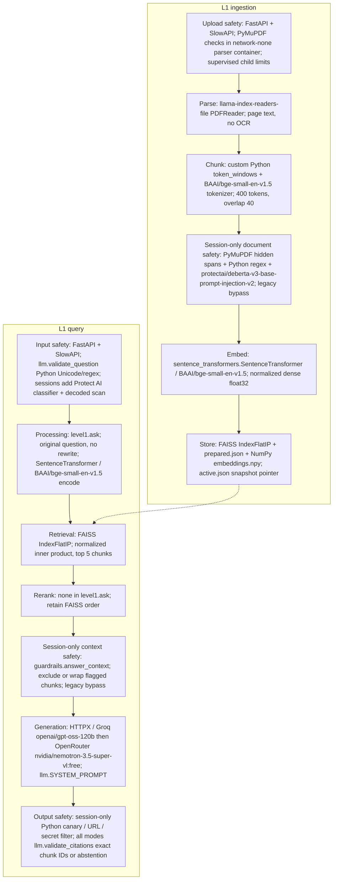
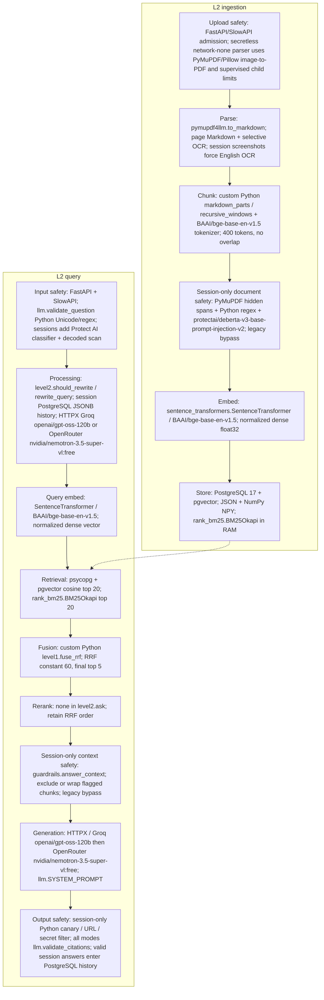
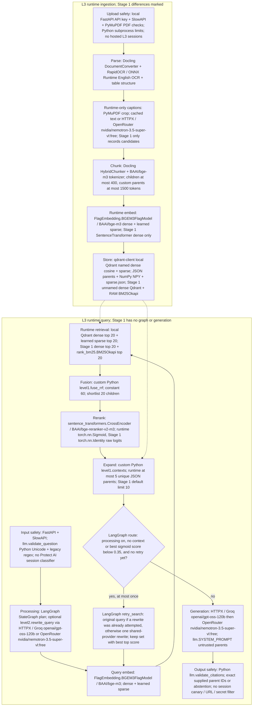

# L1, L2 and L3 flow diagrams

Verified by static source inspection on 2026-11-18. These diagrams describe the
runtime implementation; **Stage 1 evaluation** below means the original
retrieval-only benchmark (`evaluate.py --stage1`). The frozen results in
`results/` measure the runtime retrieval path with query processing off.

Scope: L1/L2 support session and legacy folder APIs. L3 supports the legacy API
and direct Python calls only (`app.SessionCreate` allows levels 1 and 2).
Session-only guards in the diagrams are bypassed in legacy mode. Direct Python
calls bypass API authentication/rate limits. Rejected inputs stop before the next
step; rejection branches are omitted for readability. Values are code defaults;
environment overrides were not read. Provider/model names describe configured
routes, not a current availability check.

“Why chosen” describes the role supported by the implementation, not a recovered
design decision or an experimentally demonstrated advantage. Function references
identify the source for each block. Package identities come from the full local `requirements.txt`; hosted app/parser resolved locks and deployment boundaries are described in [HOSTING.md](HOSTING.md). The hosted mode (designed, not yet deployed) uses an isolated parser container, shared owned exact vectors and an independent process watchdog; local CLI/L3 use the local paths shown below.

## L1

| Block | Tech | Why chosen |
| --- | --- | --- |
| Upload safety | FastAPI/SlowAPI app admission; PyMuPDF in secretless network-none parser with supervised child; `app.RequestProtection`, `level1.validate_upload_pdf`, `parse_upload` | Apply authentication/admission and upload caps, inspect PDFs, bound parser time/resources. Session creation uses Cloudflare Turnstile through HTTPX. |
| Parse | `llama-index-readers-file==0.7.0`, `PDFReader` (pypdf arrives as its dependency); `level1.parse_file` | Extract page text with page provenance; this path has no OCR. |
| Chunk | Custom `level1.token_windows` / `chunk_pages`, Hugging Face tokenizer `BAAI/bge-small-en-v1.5`; size 400, overlap 40 | Bound page-local chunks by the embedding tokenizer and retain source offsets. |
| Document safety | PyMuPDF hidden-span inspection, Python regex/normalization, Transformers CPU model `protectai/deberta-v3-base-prompt-injection-v2`; `guardrails.hidden_text_rules`, `scan_chunks` | Session uploads retain suspicious metadata before embedding; original chunk text still enters the index. Hidden-span inspection happens during parsing, and its flags are applied after chunking. |
| Embed | `sentence-transformers==5.7.0`, `SentenceTransformer`, `BAAI/bge-small-en-v1.5`; `level1.load_encoder`, `ingest_document` | Embed chunks and questions in the same space; normalize for inner-product search. Runtime upload batch size is 8; persisted vectors are float32. |
| Store | `faiss-cpu==1.15.1`, `IndexFlatIP`, JSON, NumPy NPY; `level1.open_store`, `ingest_document`, `activate_collection` | Exact local vector search; metadata is joined by row position. Uploads publish a completed snapshot before switching the active pointer. |
| Input safety | FastAPI, SlowAPI, Python `unicodedata`/`re`; session scanner and the Protect AI model; `app.session_ask`, `llm.validate_question`, `guardrails.scan_question` | Validate question length/controls and reject instruction overrides before generation. Sessions additionally scan decoded/normalized copies. |
| Processing | `level1.ask`, same SentenceTransformer encoder | Search the original question; L1 ignores the processing switch and has no conversation history. |
| Retrieval | FAISS `IndexFlatIP`, `level1.ask`; `k=min(5, chunk_count)` | Return the closest normalized dense vectors by exact inner product. |
| Rerank | None; `level1.ask` | Preserve the dense ordering; no cross-encoder is loaded. |
| Context safety | Python `guardrails.answer_context`; session-only; default document block score 0.90 | Exclude strongly suspicious chunks from answer context/citation allowlist; wrap other flagged chunks without changing retrieval. |
| Generation | HTTPX, Tenacity; configured Groq `openai/gpt-oss-120b` then OpenRouter `nvidia/nemotron-3.5-super-vl:free`; `config.LLM_CHAIN`, `llm.generate`, `answer_question` | Generate from supplied notes using the shared bounded retry/fallback chain and untrusted-context prompt. Each provider has two configured key slots; no key values are included here. |
| Output safety | Session-only `guardrails.filter_output`; all modes `llm.validate_citations` (Python regex + allowed-ID set) | Filter canary/URLs/images/secrets in sessions, then remove unknown citation IDs and replace uncited non-abstentions with `not found in the notes`. ID membership does not prove factual support. |

**Stage 1 evaluation:** same parser, chunker, dense model and FAISS family, but
`level1.run_queries` / `retrieve` collect up to 10 hits for cutoff scoring.
Runtime `level1.ask` returns at most 5. The benchmark does not run API/session
guards or generate answers.

## L2

| Block | Tech | Why chosen |
| --- | --- | --- |
| Upload safety | FastAPI/SlowAPI app; PyMuPDF/Pillow12.3.0 in secretless network-none parser with supervised child; `app.session_ingest`, `level1.image_to_pdf`, `prepare_upload`, `parse_upload` | Validate PDFs and session PNG/JPEG/WebP uploads; verify, rotate, strip image metadata, downscale and convert images before OCR. Legacy uploads remain PDF-only. |
| Parse | `pymupdf4llm==1.28.2`, `PyMuPDF==1.28.2`; `level1.parse_file` | Extract page Markdown/layout with selective OCR. Explicit screenshot options: `force_ocr=True`, `use_ocr=True`, `ocr_language="eng"`; ordinary PDFs use library defaults. OCR backend selection is automatic in installed PyMuPDF4LLM, not hardcoded to one engine in project code; the hosted parser image adds Tesseract English (`tesseract-ocr-eng`) and pins `pymupdf-layout`. |
| Chunk | `level1.markdown_parts`, `recursive_windows`, `chunk_pages`; tokenizer `BAAI/bge-base-en-v1.5`; size 400, overlap 0 | Track heading ownership and split at paragraph, newline, sentence and space boundaries before token-window fallback. |
| Document safety | Same PyMuPDF/regex/Protect AI session scan as L1; `guardrails.scan_chunks` | Attach suspicious metadata before embedding while preserving indexed text and retrieval logic. |
| Embed | SentenceTransformer `BAAI/bge-base-en-v1.5`; `level1.load_encoder`, `ingest_document`; normalized, batch 8, stored float32 | Use the same dense representation for chunks and queries. |
| Store | External Neon PostgreSQL17+ (hosted), owner-created shared session rows with RLS/TLS; `pgvector==0.5.1` Python client, `psycopg==3.3.6`, `psycopg_pool==3.3.3`; JSON/NPY snapshots; `level1.open_store`, `bm25_index` | Persist dense vectors in PostgreSQL and metadata on disk; cache BM25 by collection/signature in RAM. Exact dense search is enforced: index scans are disabled for the query. The Python package version is not the database extension version. |
| Input safety | Same shared/session question guards as L1; `app.session_ask`, `llm.validate_question`, `guardrails.scan_question` | Run input guards before any rewrite or search. |
| Processing | `level2.should_rewrite`, `rewrite_query`, `ask`; PostgreSQL JSONB history in `sessions.py`; shared HTTPX provider chain: Groq `openai/gpt-oss-120b`, OpenRouter `nvidia/nemotron-3.5-super-vl:free` | When processing is on, legacy mode always rewrites; sessions rewrite only for the history/reference or long/complex gate. Processing off keeps the original. Invalid output falls back to the original; provider exhaustion also falls back in sessions, but raises in legacy mode. |
| Query embed | SentenceTransformer `BAAI/bge-base-en-v1.5`; `level2.ask` | Encode only the selected standalone query; history is not directly embedded or sent to BM25. |
| Retrieval | pgvector `<=>` cosine through psycopg; `rank-bm25==0.2.2`, `BM25Okapi`; `level1.l2_dense_query`, `retrieve`, `lexical_tokens` | Collect up to 20 dense and 20 lexical candidates; lexical tokens use casefold plus regex `\w+`. |
| Fusion | Custom Python `level1.fuse_rrf`, `contexts`; constant 60, final 5 chunks | Combine candidate ranks without equating dense and BM25 score scales. |
| Rerank | None; `level2.ask` | Final order is RRF order; no cross-encoder or parent expansion. |
| Context safety | Session-only Python `guardrails.answer_context` | Exclude/wrap flagged answer contexts after retrieval, as in L1. |
| Generation | Same HTTPX/Tenacity Groq → OpenRouter chain as L1; `llm.answer_question` | Answer from selected chunks. Sessions supply standalone query, original question and at most the last 3 trimmed history turns as untrusted context; legacy answers use the original question. |
| Output safety/history | `guardrails.filter_output`, `llm.validate_citations`, `sessions.append_history` / `trim_history`; PostgreSQL JSONB; BGE-base tokenizer | Filter session output, validate citations in all modes, and retain only eligible L2 session turns. Default history budget is 1200 tokens; history is not evidence. |

**Stage 1 evaluation:** raw queries, no rewrite/history or generation; same dense
model, BM25 and RRF retrieval family. Existing Stage 1 uses exact pgvector search.

## L3

| Block | Tech | Why chosen |
| --- | --- | --- |
| Upload safety | FastAPI API-key route, SlowAPI, PyMuPDF, Python subprocess supervision; `app.legacy_ingest`, `level1.prepare_upload`, `parse_upload` | Validate legacy PDF uploads and bound preparation time/resources. L3 has no public session ownership/quota or session content-scanning layer. |
| Parse | `docling==2.140.0`, `DocumentConverter`, `PdfPipelineOptions`; `rapidocr==3.10.0`, `onnxruntime==1.31.0`; `level1.make_docling_converter`, `parse_file` | Extract structured text, English OCR and tables. Explicit settings enable OCR/table structure, disable built-in picture description/classification and remote services. |
| Runtime captions | PyMuPDF; HTTPX OpenRouter `nvidia/nemotron-3.5-super-vl:free`; `level1.caption_candidates`, `level3.add_captions` | Add searchable text for qualifying uncovered pictures. Candidates require area ≥5% or a text-poor page; further picture-text/visual-cue checks apply, and only pictures selected solely for a text-poor page skip the visual-cue requirement. Cache by crop/model/version hash. Nonqualifying pictures pass through without a call; Stage 1 records candidates without generating captions. |
| Chunk | Docling `HybridChunker`, `HuggingFaceTokenizer` with `BAAI/bge-m3`; custom `level1.chunk_pages` grouping | Contextualize heading-aware children ≤400 tokens (`merge_peers=True`, no overlap); group consecutive same-file/same-heading children into parents ≤1500 tokens for larger answer context. |
| Runtime embed | `FlagEmbedding==1.4.2`, `BGEM3FlagModel`, `BAAI/bge-m3`; `level3.encoder`, `encode`, `publish` | Joint dense and learned sparse representations of children and queries; batch 2, max length 512, ColBERT disabled. Keep positive sparse weights; dense stored float32. Parents are not embedded. |
| Store | `qdrant-client==1.19.1`, embedded local `QdrantClient(path=...)`; named cosine `dense` and `sparse`; JSON/NPY; `level3.open_store`, `publish` | Store both child-vector types locally; JSON supplies text, provenance and parent mapping. Runtime Qdrant payload contains only `subject` and `chunk_id`. |
| Input safety | FastAPI, SlowAPI, Python Unicode/legacy regex; `app.legacy_ask`, `llm.validate_question` | Reject invalid/instruction-override questions before graph execution. The session Protect AI classifier and decoded scan are absent from this path. |
| Processing | `langgraph==1.2.16`, `StateGraph`; `level3.plan`, `graph`; `level2.rewrite_query` with shared Groq/OpenRouter model chain | Heuristically rewrite long/ambiguous questions when processing is enabled. This is a Python-controlled graph, not an LLM planner; processing off searches the original. |
| Query embed | Same `BGEM3FlagModel` / `BAAI/bge-m3`; `level3.encode`, `retrieve` | Encode the selected search query into both vector types. |
| Retrieval | Local Qdrant named-vector search; `level3.retrieve`; up to 20 per branch | Search dense and learned sparse child vectors; skip sparse search when query weights are empty. Runtime sparse retrieval does not use BM25. |
| Fusion | Custom Python `level1.fuse_rrf`, called by `level3.retrieve`; constant 60; shortlist 20 | Merge dense/sparse candidate ranks before cross-encoding. Shared helper internally names its second branch `bm25`; L3 renames those score fields to `sparse`, and supplies learned sparse hits. |
| Rerank | Sentence Transformers `CrossEncoder`, `BAAI/bge-reranker-v2-m3`, PyTorch `torch.nn.Sigmoid`; `level3.reranker`, `retrieve` | Rerank shortlisted children against the original question, batch 2, pair max length 512. Runtime scores are sigmoid outputs; Stage 1 explicitly uses `torch.nn.Identity` raw logits. |
| Expand | Python `level1.contexts` from `level3.retrieve`; parent dictionary in `prepared.json` | Deduplicate parents in ranked-child order; each parent inherits its first/best ranked child's scores and ID. Runtime returns at most 5 parents. |
| Route | `level3.route` in LangGraph; configurable `L3_MIN_RERANK_SCORE`, default 0.35 | Allow one retrieval retry for missing/weak contexts only when processing is on; the threshold applies to runtime sigmoid scores. |
| Retry | `level3.retry_search`, `search`; optional `level2.rewrite_query` using the same provider chain | Switch to the original query if a rewrite was already attempted (accepted or rejected; after a rejected rewrite this repeats the original query), otherwise create one rewrite. Preserve the result set with the higher best score; do not merge both searches. |
| Generation | HTTPX/Tenacity shared chain: Groq `openai/gpt-oss-120b` → OpenRouter `nvidia/nemotron-3.5-super-vl:free`; `level3.answer`, `llm.answer_question` | Answer the original question from selected parent context, treated as untrusted data. A weak retry result still reaches generation. |
| Output safety | Python regex + ID set in `llm.validate_citations`; shared `llm.SYSTEM_PROMPT` | Validate parent citation membership, remove unknown IDs and abstain when citations are missing. No session output filter or semantic groundedness judge runs here. |

**Stage 1 L3 versus runtime:** `level1.prepare` / `load_encoder` use
SentenceTransformer `BAAI/bge-m3` normalized dense vectors; `level1.open_store`
creates an unnamed dense cosine Qdrant collection plus in-memory
`rank_bm25.BM25Okapi`. `level1.retrieve` fuses dense/BM25 top-20 hits; then
`level1.run_queries` applies the same reranker model with `torch.nn.Identity`
and expands up to 10 unique parents for cutoff evaluation. It generates no
captions, rewrites or answers, and runs no LangGraph retry or API/session guards.
Runtime uses the named dense/learned-sparse store, conditional captions, sigmoid
reranking and a five-parent cap shown above. Sigmoid is monotonic: it changes the
score scale and retry interpretation, not by itself the mathematical ordering of
distinct logits. Candidate/snapshot changes can change rankings; finite-precision
ties can also affect ordering. Do not treat the two paths as identical experiments.

## Scope clarifications

- Runtime L3 uses learned sparse Qdrant hits; Stage1 L3 uses BM25. They are separate retrieval paths.
- Session L1/L2 chunk/context/output scanning is shown explicitly. Legacy local L1/L2 bypasses the session layers; L3 has no hosted session route.
- “Top5” is runtime behavior. Stage1 L1 retrieves up to10, Stage1 L3 parent expansion defaults to10, and runtime L3 caps parents at5.
- L2 retains PyMuPDF4LLM layout/selective OCR defaults and explicit English forced OCR for screenshots. L3 explicitly selects RapidOCR/ONNX; no L2 parser was substituted.
- Hosted parsing crosses a bounded Unix-socket byte boundary; app never opens uploaded documents natively. App RO/parser RW socket volume does not contain executable/configuration inputs.
- Hosted L2 session WHERE/RLS applies before exact dense top20; per-session BM25/IDF/top20, stable ties, RRF60/final5 stay unchanged. The evaluation retains the legacy stores.
- Hosted deadline enforcement uses a separate watchdog process, durable operation registration, targeted session lock and app process-group restart. See HOSTING.md for restart/retention costs and unverified real-VM controls.

Static source/options describe the implementation. Real parser/model/Neon/provider behavior, native ARM performance and container confinement remain unverified.
